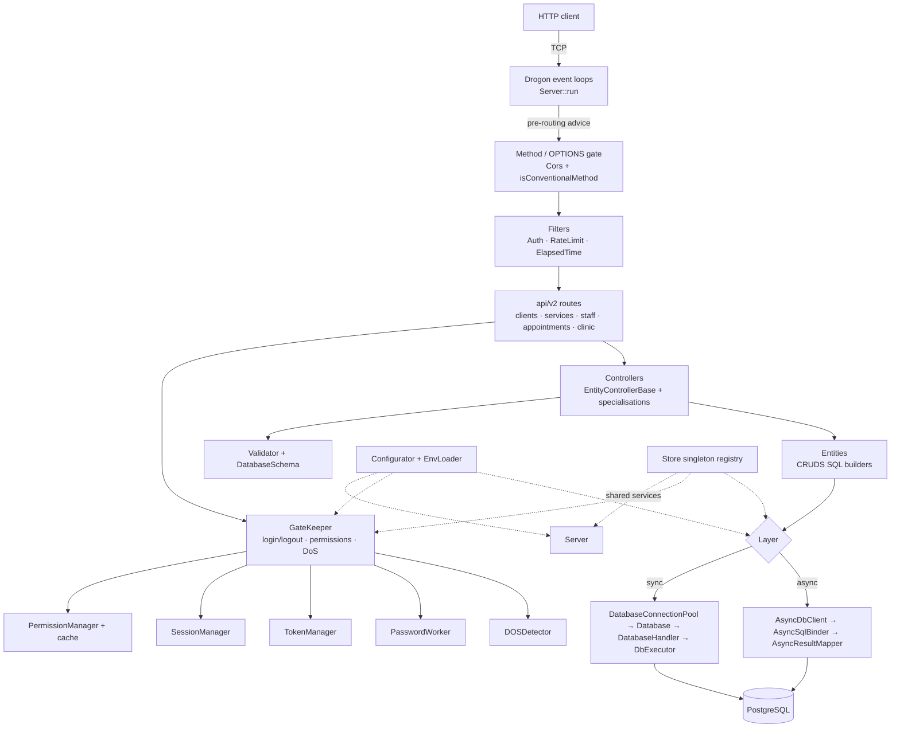

# Architecture

This document describes the runtime architecture of Project Valhalla as it is
implemented in `src/`. It is complementary to `README.md`, which focuses on
installation, configuration and API usage. For generated API reference
documentation, run `doxygen Doxyfile` and open
`build/docs/doxygen/html/index.html`.

## 1. System purpose

Valhalla is a C++20 REST service for healthcare scheduling. It exposes a JSON
HTTP API under `/api/v2` for managing clients (users and providers), services
(clinics, pharmacies, laboratories, radiology centres), staff, appointments and
clinical records. Requests are authenticated with JWT bearer tokens and
authorised against a per-entity permission model; data is persisted in
PostgreSQL through Drogon.

## 2. Technology stack

- **HTTP framework:** Drogon (event loops, routing, filters/advice, coroutines).
- **Database:** PostgreSQL, accessed either synchronously through `libpqxx`
  with a custom connection pool, or asynchronously through Drogon's `DbClient`
  (`DB_ASYNC=true`).
- **Support libraries:** `fmt` (formatting), `jsoncons` (JSON), `jwt-cpp`
  (tokens), `libsodium`/`cppcodec` (password hashing), `xxHash` (fingerprints),
  `spdlog`/Trantor (logging), cURL, ZLIB, c-ares.
- **Build:** CMake + Conan, Catch2 for tests. Dependency versions are pinned in
  `conan.lock`.

## 3. Component map

### 3.1 Bootstrap and lifecycle — `src/main.cpp`, `src/server/`

`main()` constructs `Server` behind a `std::unique_ptr` and calls `run()`,
converting any escaping `std::exception` into `EXIT_FAILURE`. `Server::run()`
prints the banner, conditionally registers the async database client, configures
the Drogon application (listener, thread count, log level, custom 404 page),
registers two pieces of advice:

- **Pre-routing advice** answers `OPTIONS` with `204` and rejects non-standard
  verbs with `405` before any route runs.
- **Pre-sending advice** is the single place CORS headers are written; it runs
  for every response, including filter-generated and pre-routing replies.

`drogon::app().run()` blocks until the event loops stop. Shutdown then drains
the `DbExecutor` and `PasswordWorker` queues *before* static destruction, in
that order, because database tasks may enqueue password work.

### 3.2 Configuration — `src/configurator/`

`Configurator` owns one `EnvLoader`-derived settings group per subsystem
(server, database, DoS detector, token manager, permission cache, password
worker, DB executor, front-end, e-mail sender). Each group's constructor reads
its environment variables with defaults declared in `defaults.hpp`;
`printValues()` logs the effective configuration with secrets redacted.
`Configurator` is itself obtained from the `Store`.

### 3.3 Service registry — `src/store/`

`Store` is a thread-safe singleton registry keyed by `std::type_index`:

- `getObject<T>()` returns the registered instance or lazily constructs one.
  Construction happens outside the lock to avoid holding the mutex during
  expensive initialisation, then is re-checked before publication so two
  concurrent first callers cannot install different instances.
- `cachedObject<T>()` is the request-path variant: a `thread_local` pointer is
  reused until a generation counter changes, avoiding a mutex and hash lookup
  per request.
- `replaceObject<T>()` swaps an instance (used by tests to inject fakes) and
  increments the generation counter so every thread refreshes its cache.
- Registered objects are held as `std::shared_ptr<void>` and handed out as
  aliased `shared_ptr<T>`: ownership is shared, not transferred.

### 3.4 Gatekeeper — `src/gatekeeper/`

`GateKeeper` is the authentication/authorisation façade. It parses credentials,
delegates password verification to `PasswordWorker`, issues and validates JWTs
via `TokenManager`, tracks sessions in `SessionManager`, checks per-entity
rights in `PermissionManager` (backed by an idle-expiry `PermissionCache`), and
detects abuse in `DOSDetector`. Most operations exist in two forms: a callback
version used by synchronous controllers and a `drogon::Task` coroutine version
used by asynchronous controllers.

### 3.5 Controllers — `src/controllers/`

`EntityControllerBase` is the CRUDS contract (`Create`, `Read`, `Update`,
`Delete`, `Search`), each with a synchronous callback overload and an
asynchronous `drogon::Task<void>` overload. Concrete controllers (client,
clinic, service, staff, appointment, generic entity, database) implement that
contract. They validate input with `Validator`, authorise through `GateKeeper`,
build an `Entity`, and hand it to the database layer; results are marshalled to
JSON and delivered through the `CALLBACK_` (`std::function<void(int,
std::string)>`) or the coroutine.

### 3.6 Entities and validation — `src/entities/`, `src/validator/`

`Base` declares the SQL-statement interface; `Entity` implements it with a
builder per operation and a `Binder` that produces parameter placeholders
(so values are never concatenated into SQL). `Types.hpp` defines the per-action
value types (`Create_t`, `Read_t`, `Update_t`, `Delete_t`, `Search_t`) collected
into the `EntityType` variant. `Validator` applies schema-driven rules
(nullability, immutability, presence) using bitmask `Rule::Action` flags;
`DatabaseSchema` supplies the table metadata.

### 3.7 Database layer — `src/database/`

Two interchangeable paths:

- **Synchronous (default):** `DatabaseConnectionPool` owns `Database`
  connections; `DatabaseHandler` borrows and returns them (with reconnect on
  failure); `DbExecutor` serialises work onto a `BlockingPool` worker queue;
  `Watchdog` checks pool health. `DatabaseBusy` is thrown when no connection is
  available within the configured timeout and maps to HTTP 503 via
  `statusForException()`.
- **Asynchronous (`DB_ASYNC=true`):** `AsyncDbClient` wraps Drogon's
  `DbClient`; `AsyncSqlBinder` binds parameters and `AsyncResultMapper` maps
  rows back to domain values; `AsyncDbError` represents failures. This client
  is registered in the `Store` only when the flag is enabled.

### 3.8 Utilities — `src/utils/`, `src/concurrency/`

Logging (`Logger`, `Message`), JSON helpers, an in-process `MemCache`, a
`ThreadSafeQueue`, CORS token helpers, global HTTP/status types, and
`BoundedExecutor` (a bounded worker pool used where work must be throttled).

## 4. Execution and data flow

1. A request arrives on a Drogon event-loop thread.
2. Pre-routing advice handles `OPTIONS`/unsupported verbs; filters authenticate
   (`Auth`), apply rate limits (`RateLimit`) and record elapsed time.
3. The matched route parses the JSON body into a domain value type, asks
   `GateKeeper` to authorise the operation, and invokes the controller.
4. The controller validates fields, constructs an `Entity`, and submits SQL
   through the sync pool or async client.
5. Rows are mapped back to JSON; the pre-sending advice attaches CORS headers
   and Drogon writes the response.
6. On shutdown the event loops stop first, then the executor and password worker
   queues are drained while the `Store` singletons still exist.

## 5. Concurrency model

- Drogon owns the HTTP event-loop threads (`config_.threads`).
- `Store` protects its registry with a mutex; `cachedObject<T>` avoids that
  mutex on hot paths using `thread_local` state and an atomically-read
  generation counter (`memory_order_acquire`/`release`).
- The synchronous database path funnels work through `BlockingPool`/`DbExecutor`
  worker threads and checks out pooled connections with an acquire timeout.
- `PasswordWorker` runs hashing off the request threads.
- `DOSDetector` keeps mutable counters shared across request threads; its
  injectable clock is a test seam.
- Coroutine (`drogon::Task`) variants suspend rather than block event-loop
  threads while waiting on asynchronous I/O.

## 6. Ownership and lifetime

- Long-lived services are shared singletons in `Store` (`shared_ptr`).
- The `Server` is uniquely owned in `main()`; its member services are shared.
- Database connections are borrowed from the pool via `shared_ptr` and returned
  on destruction of the handler; the executor and worker are explicitly drained
  at shutdown rather than relying on static destruction order.
- Callbacks are captured by value into Drogon's continuation chain; coroutine
  variants keep their arguments alive across suspension points.

## 7. Key architectural decisions

- **Advice-based CORS:** a single pre-sending hook guarantees headers on every
  response, including errors produced by filters and advice.
- **Dual database paths:** the synchronous pool supports deterministic tests and
  simple deployment, while the async path scales I/O without blocking event
  loops; selection is a configuration flag, not a code change.
- **Store with generation-based caching:** centralises singleton lifetime while
  keeping per-request lookups cheap and test-injectable.
- **Paired sync/async APIs:** every controller and gatekeeper capability has a
  coroutine twin so the same logic can be used from both execution models.
